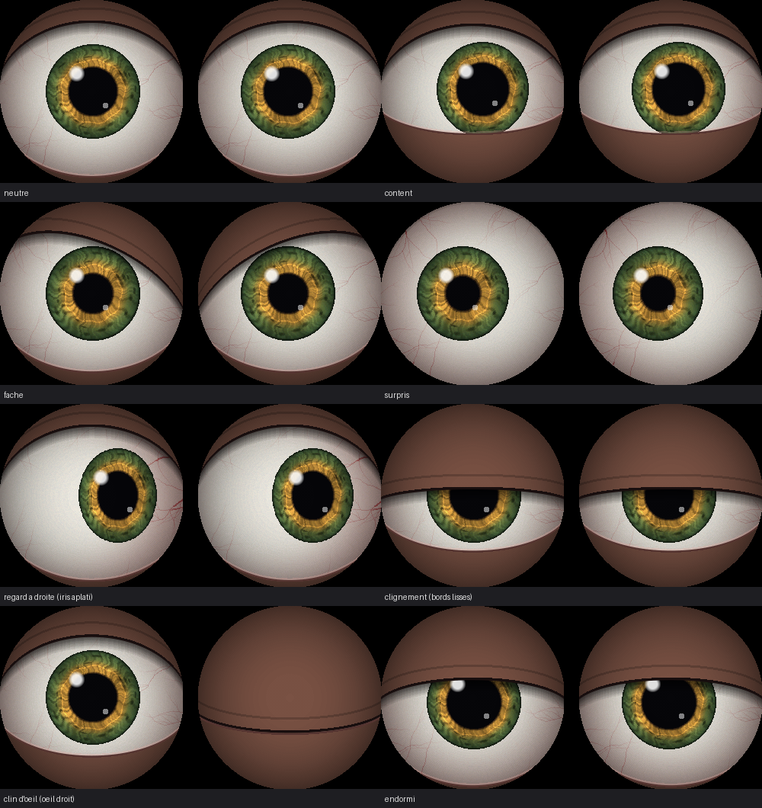

# Opal — le corps matériel d'Iris

Opal est un boîtier vocal ESP32-S3 : tu maintiens le bouton, tu parles, Iris
(qui tourne sur le PC) te répond par le haut-parleur.

```
 [INMP441] --I2S--> ESP32-S3 --WiFi/WebSocket--> server/opal_bridge.py --> Iris (Brain)
 [MAX98357A] <--I2S--   (N16R8)     <--- PCM 24 kHz ---   STT local + TTS PCM
```

## Matériel

| Module | Broche module | GPIO ESP32-S3 |
|---|---|---|
| Micro INMP441 | SCK | 5 |
| | WS | 6 |
| | SD | 4 |
| | L/R | GND |
| | VDD / GND | 3V3 / GND |
| Ampli MAX98357A | BCLK | 15 |
| | LRC | 16 |
| | DIN | 7 |
| | VIN / GND | 5V / GND |
| | SD, GAIN | non connectés |
| Bouton push-to-talk | — | 0 (bouton BOOT intégré) |
| LED RGB intégrée | — | 48 (38 sur DevKitC-1 v1.1) |

Ne pas utiliser les GPIO 35, 36, 37 : ils sont réservés à la PSRAM octale du N16R8.
Toutes les broches se changent dans [firmware/include/config.h](firmware/include/config.h).

LED : orange = connexion, cyan = prêt, vert = écoute, violet = réflexion,
bleu = parle, rouge = erreur.

Yeux : endormis pendant la connexion, regard libre au repos, grands ouverts
et fixés sur toi pendant l'écoute, en haut à droite pendant la réflexion,
contents quand Opal parle, tristes en cas d'erreur.

## Yeux (2 écrans ronds GC9A01)



Chaque écran a son propre bus SPI (les deux sont rafraîchis en parallèle en DMA).

| Broche écran | Œil gauche | Œil droit |
|---|---|---|
| VCC / GND | 3V3 / GND | 3V3 / GND |
| SCL | 12 | 2 |
| SDA | 11 | 1 |
| DC | 10 | 42 |
| CS | 9 | 41 |
| RST | 14 | 14 (commun) |
| BLK | 3V3 | 3V3 |

Démo seule (humeurs en boucle, pilotable depuis le moniteur série) :

```bash
cd firmware && pio run -e eyes -t upload -t monitor
```

Touches : `n` neutre, `h` content, `s` triste, `a` fâché, `u` surpris,
`z` endormi, `b` cligner, `w`/`q`/`x`/`d`/espace pour orienter le regard,
`g` regard automatique, `p`/`P` pupille serrée/dilatée, `c` couleur d'iris.

Si l'image est parasitée, passer `EYE_SPI_HZ` à 40 MHz ; si les couleurs sont
inversées, `EYE_INVERT` à `false` ; si un œil est tourné, `EYE_L/R_ROTATION`
([firmware/include/config.h](firmware/include/config.h)).

## 1. Lancer le pont sur le PC

Le pont utilise le venv et le `.env` d'Iris (`C:\Users\harrm\Documents\Iris`) :

```bash
../Iris/.venv/Scripts/python.exe server/opal_bridge.py --iris-dir ../Iris
```

Il écoute sur `ws://0.0.0.0:8765`. Au premier lancement, Windows demande
d'autoriser Python sur le réseau privé : accepter.

Voix : TTS OpenAI (PCM) si `IRIS_TTS_BACKEND=openai` avec une clé OpenAI,
sinon la voix Windows (SAPI). Transcription : celle d'Iris (`IRIS_STT_ENGINE`).

## 2. Flasher l'ESP32

1. Copier `firmware/include/secrets.example.h` en `firmware/include/secrets.h`
   et remplir le WiFi + l'IP du PC (`ipconfig` → Adresse IPv4).
2. Brancher la carte sur le port USB marqué **USB** (ou **COM**), puis :

```bash
cd firmware && pio run -t upload -t monitor
```

## Protocole

Documenté en tête de [server/opal_bridge.py](server/opal_bridge.py) :
JSON pour le contrôle, trames binaires PCM 16 bits mono pour l'audio
(16 kHz micro → PC, 24 kHz PC → haut-parleur).

## Réglages utiles

- Micro trop faible / saturé : `MIC_GAIN_SHIFT` (plus petit = plus fort).
- Volume : `SPK_VOLUME` (0–100).
- Appuyer pendant qu'Opal parle l'interrompt et relance l'écoute.
