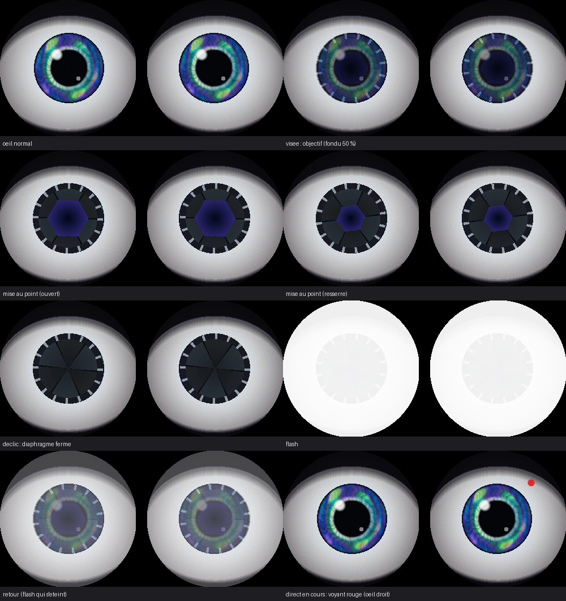

# Opal — le corps matériel d'Iris

Opal est un boîtier vocal ESP32-S3 : tu maintiens le bouton, tu parles, Iris
(qui tourne sur le VPS) te répond par le haut-parleur.

```
 [INMP441] --I2S--> ESP32-S3 --wss + jeton--> Traefik --> opal-bridge --/api/command--> Opal (iris)
 [MAX98357A] <--I2S--   (N16R8)   <--- PCM 24 kHz ---   Whisper (VPS) + voix Edge
```

## Matériel

| Module | Broche module | GPIO ESP32-S3 |
|---|---|---|
| Micro INMP441 | SCK | 5 |
| | WS | 6 |
| | SD | 4 |
| | L/R | GND |
| | VDD / GND | 3V3 / GND |
| Ampli MAX98357A | BCLK | 15 |
| | LRC | 16 |
| | DIN | 7 |
| | VIN / GND | 5V / GND |
| | SD, GAIN | non connectés |
| Bouton push-to-talk | — | 0 (bouton BOOT intégré) |
| LED RGB intégrée | — | 48 (38 sur DevKitC-1 v1.1) |

Ne pas utiliser les GPIO 35, 36, 37 : ils sont réservés à la PSRAM octale du N16R8.
Toutes les broches se changent dans [firmware/include/config.h](firmware/include/config.h).

LED : orange = connexion, cyan = prêt, vert = écoute, violet = réflexion,
bleu = parle, rouge = erreur.

Yeux : endormis pendant la connexion, regard libre au repos, grands ouverts
et fixés sur toi pendant l'écoute, en haut à droite pendant la réflexion,
contents quand Opal parle, tristes en cas d'erreur.

## Yeux (2 écrans ronds GC9A01)

Iris « opale » irisé (bleu, turquoise, vert, violet, éclats dorés), paupières noir
mat qui se fondent dans le bord de l'écran, un œil calculé par cœur du processeur.


Chaque écran a son propre bus SPI (les deux sont rafraîchis en parallèle en DMA).

| Broche écran | Œil gauche | Œil droit |
|---|---|---|
| VCC / GND | 3V3 / GND | 3V3 / GND |
| SCL | 12 | 2 |
| SDA | 11 | 1 |
| DC | 10 | 42 |
| CS | 9 | 41 |
| RST | 14 | 14 (commun) |
| BLK | 3V3 | 3V3 |

Démo seule (humeurs en boucle, pilotable depuis le moniteur série) :

```bash
cd firmware && pio run -e eyes -t upload -t monitor
```

Touches : `n` neutre, `h` content, `s` triste, `a` fâché, `u` surpris,
`z` endormi, `b` cligner, `w`/`q`/`x`/`d`/espace pour orienter le regard,
`g` regard automatique, `p`/`P` pupille serrée/dilatée, `c` couleur d'iris.

**Mode appareil photo** : quand Opal prend une photo, l'iris des deux yeux devient un
objectif (diaphragme à 6 lamelles qui fait la mise au point, bague crantée), puis
déclic et flash blanc à la prise de vue. Pendant que quelqu'un regarde le direct,
un voyant rouge pulse sur l'œil droit. Démo : touches `f` (photo) et `r` (voyant).



Si l'image est parasitée, passer `EYE_SPI_HZ` à 40 MHz ; si les couleurs sont
inversées, `EYE_INVERT` à `false` ; si un œil est tourné, `EYE_L/R_ROTATION`
([firmware/include/config.h](firmware/include/config.h)).

## Caméra (ESP32-CAM AI-Thinker, OV2640)

La caméra envoie ses images au pont (wss, même jeton que les yeux). Sur le VPS :

- **les yeux te suivent** : détection de visage YuNet, direction envoyée à Opal Box ;
- **présence** : à ton arrivée les yeux se réveillent, Opal reçoit l'événement
  `personne_arrivee` et te salue à voix haute (1 fois par heure max) ; sans
  personne pendant 45 s, `personne_partie` et les yeux s'endorment ;
- **Opal voit sur demande** : outils `opal_box_photo` (photo 800x600 décrite par
  Claude Code, ton abonnement) et `opal_box_presence` ;
- **direct vidéo** : https://iris.inoma.pro/opal/cam (sans mot de passe depuis un
  navigateur connecté à Opal ; sinon n'importe quel identifiant + le mot de passe
  `OPAL_VIEWER_PASSWORD` du VPS). Deux modes : « Fluide » (~3 images/s) et « Net »
  (640x480, ~1,5 image/s avec un GC2145) ; l'image est améliorée sur le VPS
  (agrandissement, contraste local, netteté).

Afficher le mot de passe du direct :

```bash
ssh ubuntu@51.210.177.60 "grep OPAL_VIEWER_PASSWORD Opal_esp32/deploy/opal-bridge.env"
```

Flasher (même `firmware/include/secrets.h`). L'ESP32-CAM n'a pas d'USB : on se sert
de l'ESP32-S3 comme adaptateur USB-série (aucun achat nécessaire).

1. Flasher la passerelle sur l'S3 :
   `& "$env:USERPROFILE\.platformio\penv\Scripts\pio.exe" run -e cam-flasher -t upload`
2. Câbler (fils dupont femelle-femelle), S3 débranché :

   | ESP32-S3 | ESP32-CAM |
   |---|---|
   | 5V | 5V |
   | GND | GND |
   | GPIO17 | U0R |
   | GPIO18 | U0T |
   | — | IO0 relié à GND (le temps du flash) |

3. Rebrancher l'S3 en USB, appuyer sur **RST** au dos de la caméra, puis :
   `& "$env:USERPROFILE\.platformio\penv\Scripts\pio.exe" run -e cam -t upload`
   (environ 2 minutes à 115200 bauds).
4. Retirer le fil IO0–GND, appuyer sur RST : la caméra démarre ; ses messages
   passent par l'S3 (`... device monitor -e cam`).
5. Reflasher l'S3 avec `-e opal-s3`, puis alimenter la caméra seule en 5V
   (5V + GND, 500 mA minimum).

Avec un socle ESP32-CAM-MB ou un adaptateur FTDI, même principe : IO0 à GND +
RST avant le flash (le flash ne fait aucun reset automatique).

Si les yeux regardent du mauvais côté : `OPAL_CAM_MIRROR=1` dans le fichier du pont
sur le VPS. Si l'image est à l'envers : `CAM_VFLIP` / `CAM_HMIRROR` dans
[firmware/src/cam_main.cpp](firmware/src/cam_main.cpp).

Bon à savoir sur la caméra :

- **Capteur GC2145** (nappe marquée « RHYX M21-45 », souvent vendu comme OV2640) :
  pas de JPEG matériel, l'ESP32 compresse lui-même. Le pont limite alors le flux à
  2 images/s pour le suivi et 3 images/s (QVGA) pour le direct : au-delà, son WiFi
  décroche. Un vrai OV2640 garde 4 et 10 images/s.
- **Alimentation** : la broche 5V de l'ESP32-S3 N16R8 ne fournit pas de courant ;
  en attendant une alimentation 5V dédiée (chargeur USB, 1 A), la caméra tourne sur
  le 3V3 de l'S3.
- **Mises à jour par WiFi** (après le premier flash par fil), même réseau que le PC :
  `& "$env:USERPROFILE\.platformio\penv\Scripts\pio.exe" run -e cam-ota -t upload`
  (le pare-feu Windows doit autoriser Python sur le réseau).
- Messages de la caméra : à travers la passerelle S3, sur son port USB natif ou sur
  son port COM.

**Photos dans le chat d'Opal** : l'interface web d'Opal affiche les liens
`/opal/cam/photos/<id>.jpg` comme des images (patch [deploy/iris-chat-photos.patch](deploy/iris-chat-photos.patch),
appliqué sur le VPS le 2026-10-24). À réappliquer si Opal est redéployé depuis une
autre copie de son code : `patch -p1 < iris-chat-photos.patch` dans le dossier d'Iris,
puis `docker compose -p iris up -d --build iris` dans `Iris/deploy`.

## 1. Le pont sur le VPS (Docker + Traefik)

Le pont (`server/`) ne contient pas de cerveau : il transcrit la voix en local
(faster-whisper), envoie le texte à l'API d'Opal (`POST /api/command` du
conteneur `iris`, la même conversation que sur le PC et le Mac), puis renvoie
la réponse avec la voix Edge d'Opal.

L'ESP32 s'y connecte en `wss://iris.inoma.pro/opal` : Traefik envoie le chemin
`/opal` au conteneur `opal-bridge`, avec le certificat d'Opal. L'accès est
protégé par un jeton (`Authorization: Bearer`), stocké sur le VPS dans
`~/Opal_esp32/deploy/opal-bridge.env` et dans `firmware/include/secrets.h`.

Tant qu'Opal Box est connectée, le pont se présente aussi à Opal comme un
nœud « opal-box » (comme le PC et le Mac, voir [server/node.py](server/node.py)).
Opal gagne l'outil `opal_box_yeux` : humeur, regard, clignement, pupilles,
pendant `duree_s` secondes, puis les yeux reprennent leur comportement auto.
Exemple à dire ou écrire à Opal : « fais-moi un clin d'œil avec un air content ».

Mettre à jour le pont après une modification de `server/` :

```bash
scp server/Dockerfile server/requirements.txt server/*.py ubuntu@51.210.177.60:Opal_esp32/server/
ssh ubuntu@51.210.177.60 "cd Opal_esp32/deploy && docker compose -p opal-box up -d --build"
```

Journal : `ssh ubuntu@51.210.177.60 docker logs -f opal-bridge`

## 2. Flasher l'ESP32

1. Copier `firmware/include/secrets.example.h` en `firmware/include/secrets.h`
   et remplir : WiFi, `iris.inoma.pro`, jeton (même valeur que `OPAL_DEVICE_TOKEN` sur le VPS).
2. Brancher la carte sur le port USB marqué **USB** (ou **COM**), puis :

```powershell
cd firmware
& "$env:USERPROFILE\.platformio\penv\Scripts\pio.exe" run -e opal-s3 -t upload -t monitor
```

## Protocole

Documenté en tête de [server/opal_bridge.py](server/opal_bridge.py) :
JSON pour le contrôle, trames binaires PCM 16 bits mono pour l'audio
(16 kHz micro → VPS, 24 kHz VPS → haut-parleur).

## Réglages utiles

- Micro trop faible / saturé : `MIC_GAIN_SHIFT` (plus petit = plus fort).
- Volume : `SPK_VOLUME` (0–100).
- Appuyer pendant qu'Opal parle l'interrompt et relance l'écoute.
